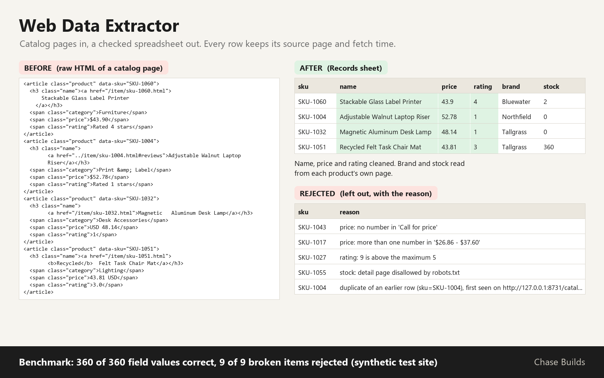

# web-data-extractor

[](https://github.com/chasebuilds/web-data-extractor/actions/workflows/ci.yml)  [](LICENSE)

Turns a public catalog-style website into a checked spreadsheet, driven by one small config file, and only when the site's robots.txt allows it. Every row carries the page it came from and when it was fetched.



## Measured result

From [BENCHMARK.md](BENCHMARK.md), written by `benchmark/run_benchmark.py` from a real run against the bundled test site (72 listings on 6 pages, generated from a seeded truth file, with 9 broken items and 3 repeat listings planted in it):

| Measure | Result |
|---|---|
| Valid products found | 60 of 60 |
| Field values correct | 360 of 360 |
| Broken items sent to the Rejected sheet, with the expected reason | 9 of 9 |
| Valid products wrongly rejected | 0 |
| Repeat listings flagged as duplicates | 3 of 3 |
| Listings accounted for (Records + Rejected) | 72 of 72 |
| Requests made to the section robots.txt disallows | 0 |
| Shortest gap between two requests, timed by the test server | 0.502 s (limit 0.5 s) |

The benchmark also runs a layout-change drill: the same job with the price selector pointed at an element that is not there. Result: 0 records written, 72 of 72 listings in Rejected with a reason, run health "attention", exit code 1, and only 7 requests made.

The test site and its config were written together, so this shows the engine and its checks work. It is not a promise about a site the tool has never seen. Each new site gets its own config and its own spot check.

## Before and after

Before, three listings as they appear in the HTML ([samples/fixture/input_catalog_page-1.html](samples/fixture/input_catalog_page-1.html)):

```html
<article class="product" data-sku="SKU-1032">
  <h3 class="name"><a href="/item/sku-1032.html">Magnetic   Aluminum Desk Lamp</a></h3>
  <span class="category">Desk Accessories</span>
  <span class="price">USD 48.14</span>
  <span class="rating">1</span>
</article>
<article class="product" data-sku="SKU-1051">
  <h3 class="name"><a href="/item/sku-1051.html"><b>Recycled</b>  Felt Task Chair Mat</a></h3>
  ...
<article class="product" data-sku="SKU-1017">
  ...
  <span class="price">$26.86 - $37.60</span>
```

After, the `Records` sheet ([samples/fixture/fixture-catalog.xlsx](samples/fixture/fixture-catalog.xlsx)). Brand and stock come from each product's own page:

| sku | name | category | price | rating | brand | stock | source_url | fetched_at |
|---|---|---|---|---|---|---|---|---|
| SKU-1032 | Magnetic Aluminum Desk Lamp | Desk Accessories | 48.14 | 1 | Tallgrass | 0 | .../catalog/page-1.html | 2026-11-21T05:01:26Z |
| SKU-1051 | Recycled Felt Task Chair Mat | Lighting | 43.81 | 3 | Tallgrass | 360 | .../catalog/page-1.html | 2026-11-21T05:01:26Z |

And the `Rejected` sheet, for rows that could not be trusted:

| reason | sku | name | price |
|---|---|---|---|
| price: more than one number in '$26.86 - $37.60' | SKU-1017 | Heavy-Duty Canvas File Box | $26.86 - $37.60 |
| price: no number in 'Call for price' | SKU-1043 | Modular Felt Laptop Riser | Call for price |
| stock: detail page disallowed by robots.txt | SKU-1055 | Slim Canvas Wall Shelf | 39.05 |
| duplicate of an earlier row (sku=SKU-1004), first seen on .../catalog/page-1.html | SKU-1004 | Adjustable Walnut Laptop Riser | 52.78 |

## Quick start

Python 3.11 or newer, inside a virtual environment:

```
pip install -e .
wde demo
wde run configs/quotes_toscrape.yaml --out out/quotes
```

`wde demo` serves the bundled test site on your own machine, extracts it, and writes `out/fixture/`. It needs no internet and takes about 35 seconds, because it waits half a second between requests even locally. The third command reads two pages of [quotes.toscrape.com](https://quotes.toscrape.com), a sandbox site built for scraping practice.

Other commands:

```
wde validate configs/books_toscrape.yaml     # check a config, no network use
wde run configs/books_toscrape.yaml --out out/books
python benchmark/run_benchmark.py            # rebuild the test site, score it, rewrite BENCHMARK.md
pytest                                       # 173 tests, all offline
```

## How it works

1. **Config.** A YAML file names the start URLs, a CSS selector for one item, and a selector per field. A field can read text or an attribute, pull part of it out with a regex, map words to values, and be cast to a number, integer or absolute URL. See [configs/fixture.yaml](configs/fixture.yaml) for a full example.
2. **Fetch.** Every request goes through one function. Before each one it checks the host's robots.txt and refuses a disallowed path without contacting the server. It waits at least the configured delay between requests to one host (never under 0.5 s), uses the site's `Crawl-delay` when that is longer, retries 429 and 5xx answers with growing backoff, and keeps a disk cache so a rerun does not hit the site again. robots.txt is read again at least every 24 hours.
3. **Stop when the site says no.** `Retry-After` is honored in full, as seconds or as a date. If the site asks for a longer wait than the backoff cap (60 s by default), the job ends for that host and does not come back early. Three answers of 403 or 429 in a row, or a page whose title reads like a block, CAPTCHA or consent wall, also end the job for that host. The run then exits with a non-zero code and the Summary sheet says why. There is no retry around a block.
4. **Paginate.** Follow a "next" link, or walk a numbered page pattern, up to a page cap.
5. **Detail pages.** Optionally follow each item's link for more fields. Duplicates and rows that already failed are skipped first, so they cost the site nothing.
6. **Validate.** Required fields, types, min and max. A value that cannot be read rejects the row if the field is required, and becomes a note in the `warnings` column if it is optional. Nothing is guessed: a price range is rejected, not cut to its first number.
7. **Export and check.** Write the workbook, open it again, and compare row counts and headers with what was meant to be written. The result of that check is on the Summary sheet.

The compliance rules are covered by tests in [tests/test_compliance.py](tests/test_compliance.py) and [tests/test_stop_rules.py](tests/test_stop_rules.py): a disallowed path is refused and the server never sees it, the delay is enforced, a zero delay in a config is rejected, a 429 triggers backoff, an over-long `Retry-After` or a block page ends the job for that host.

Before a job runs against a new site, a person reads that site's terms of use and records it in the config's `terms_check` block (URL, date read, the clause on automated access). The tool refuses to run against any host other than this machine and the two sandbox sites without that record, and copies it into the Summary sheet.

Other guards:

- **Run health.** A `health` block sets the least records expected, the least share of listings each field must be filled on, and the most that may be rejected. If a run misses any of them, `wde run` exits with code 1 and the Summary says which.
- **Personal details.** A text value that looks like a personal email address or a phone number is withheld from both Records and Rejected, with a note. Shared mailboxes such as `info@` are kept.
- **Backoff jitter.** Retry waits are stretched by up to 25 percent. Jitter only adds time.

Example field definitions:

```yaml
price:
  selector: ".price_color"
  type: number
  min: 0.01
  required: true
rating:
  selector: "p.star-rating"
  attr: class
  regex: 'star-rating (\w+)'
  map: {One: 1, Two: 2, Three: 3, Four: 4, Five: 5}
```

## What a client receives

One XLSX workbook and the same four tables as CSV files:

| Sheet | Contents |
|---|---|
| `Records` | The clean rows. Each has `source_url`, `fetched_at` (UTC), a SHA-256 of the page it was read from, the same three for the detail page if one was read, and a `warnings` column. |
| `Rejected` | Every row that was left out, with the reason and the text that was on the page. |
| `RunLog` | Every URL the tool tried, in order: HTTP status, cache hit or not, the robots.txt decision, the attempt number, and the wait before it. |
| `Summary` | Counts, fill rate per field, the delay used per host, refusals, caps that were hit, the tool version, a hash of the config, the terms record, run health, and the export check. |

Text that starts with `=`, `+`, `-` or `@` is stored as plain text, so a scraped value cannot run as a spreadsheet formula.

Sample outputs are in [samples/](samples/): the bundled test site, plus one small run each of books.toscrape.com (1 list page, 20 detail pages) and quotes.toscrape.com (2 pages, quote text and tags only; author names are left out because named individuals count as personal data). Each sandbox site was fetched once. The two sandbox samples were later rebuilt from the disk cache when columns were added, so their RunLog sheets show cache hits and no new requests, and `fetched_at` still shows the time of the one real fetch.

## Limits

No logins, no CAPTCHA handling, no proxy rotation or browser disguise, no personal data, and no way to switch off robots.txt checks or the delay. Pages that need JavaScript to show their data are out of scope. The full list is in [LIMITATIONS.md](LIMITATIONS.md).

## License

MIT, see [LICENSE](LICENSE). Copyright Chase Builds.
